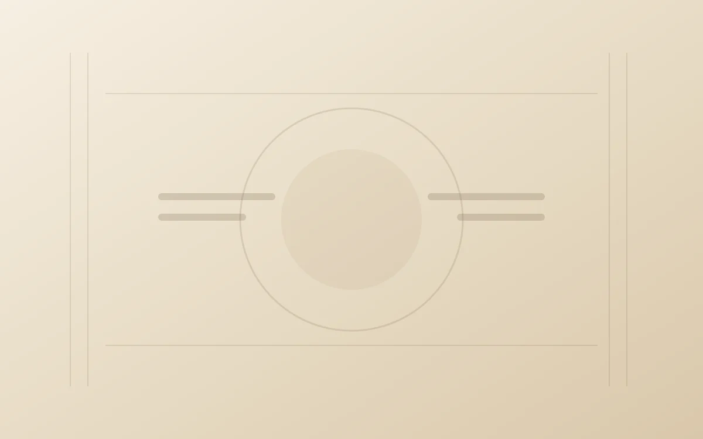

本篇为全要素排版基准测试文章（Test Suite），用于全面检验与验证博客的排版渲染能力与交互特性。右侧目录导航（TOC）会自动读取所有 `H2` 到 `H4` 分级标题，并支持平滑居中滚动跟随与进度追踪。

---

## 1. 分级标题与排版样式

良好的文章脉络能有效降低阅读负担。本节检验多级标题的字号梯级、间距与锚点链接。

### 1.1 三级子标题示例

这是三级标题（`H3`）下的段落内容。正文字号舒适，行高适中（1.75），段间距具备舒适的呼吸感。

#### 1.1.1 四级深层小节测试

这是四级标题（`H4`）下的正文。测试更深层级的结构在目录树与文章体中的缩进及视觉层级。

### 1.2 行内富文本与装饰标记

正文排版全面支持标准的 Markdown 行内元素及常用 HTML5 语义化标签：

- **粗体强调（Bold）**：用于突出核心观点、结论或关键词。
- *斜体强调（Italic）*：用于外文术语、专有名词或特定书名。
- ***粗斜体结合***：用于双重强调关键警告或警示语。
- ~~删除线文本（Strikethrough）~~：用于标记已废止、重构或更正的前置论点。
- <mark>荧光高亮标记（Mark）</mark>：模拟记号笔重点划线高亮。
- <u>带下划线文本（Underline）</u>：用于特定标识强调。
- `行内代码（Inline Code）`：使用专用等宽字族展示标识符，如 `const theme = 'dark';` 或 `npm run dev`。
- 上标与下标展示：常见化学分子式如 H<sub>2</sub>O、CO<sub>2</sub>；数学与物理公式如 E = mc<sup>2</sup>，x<sup>2</sup> + y<sup>2</sup> = r<sup>2</sup>。
- 键盘快捷键徽标：按下 <kbd>Ctrl</kbd> + <kbd>K</kbd> 呼出全站秒级瞬时搜索，按 <kbd>ESC</kbd> 退出弹窗。
- 外部安全链接：[访问 Astro 官方现代文档](https://docs.astro.build)（自动附加安全外链属性与右上角外链指示图标）。

---

## 2. 交互式警告提示框（Callouts）

系统内置原生渲染的五类呼应警告框（GitHub / Obsidian 规范），支持专用色彩、图标与柔和渐变底色：

> [!NOTE]
> **说明提示框（Note）**：这是普通说明或背景知识补充，用于提供补充性的上下文信息。

> [!TIP]
> **小技巧与建议（Tip）**：建议将静态图片资源置于 `src/assets/` 下，以便 Astro 自动生成现代 WebP 格式与响应式优化尺寸。

> [!IMPORTANT]
> **核心要点（Important）**：全站主题切换、字体排版状态均已集成至统一的持久化状态机中，实现客户端换页零闪烁同步。

> [!WARNING]
> **警告注意事项（Warning）**：修改全局设计变量（CSS Tokens）前，请在浅色与深色模式下分别核验文字对比度（确保符合 WCAG AA 标准）。

> [!CAUTION]
> **高危警示（Caution）**：直接覆盖底层核心构建配置前请备份现有改动，不当操作可能导致打包流程阻断。

---

## 3. 引用与名言（Blockquote）

### 3.1 经典单层引用

> 纸上得来终觉浅，绝知此事要躬行。  
> —— 陆游《冬夜读书示子聿》

### 3.2 深度多层嵌套引用

> 优秀的界面设计是看不见的设计。它顺应直觉，让读者专注于内容本身。
>
> > 每一处间距的留白、每一种字阶的比例，都是为了在浮躁的信息流中构筑一方安静而纯粹的自留地。
> >
> > > 知行合一，躬行实践，方得始终。

---

## 4. 图片排版与画廊灯箱（Lightbox Zoom）

博客内置纯原生无依赖的高性能图片灯箱（Image Lightbox）。点击任意图片即可无缝平滑放大，支持键盘 <kbd>ESC</kbd> 键、点击遮罩或再次轻触图片即可退出。

### 4.1 单张高清大图与居中图注

下图测试了自适应居中排版、原图等比例缩放（不拉伸不变形）、投影效果以及图注（Caption）样式：


<div align="center"><small style="color:var(--c-text-2)">图 1：基于 CSS Custom Properties 的设计变量架构体系（点击呼出灯箱）</small></div>

### 4.2 双列对称画廊对比

测试双列等宽网格画廊展示，两张图片均严格按原图宽高比自适应对齐，可独立点击呼出无损灯箱：

| 视角 A：极简纯粹界面 | 视角 B：沉浸书页质感 |
| :---: | :---: |
|  |  |
| *极简交互体验* | *衬线与经典阅读网格* |

### 4.3 三列网格画廊展示

测试三列等宽网格画廊展示，各列严格等分且图片完整保持原始比例：

| 技术体系 | 现代规范 | 阅读体验 |
| :---: | :---: | :---: |
|  |  |  |
| *技术架构探索* | *内容驱动排版* | *沉浸式心流* |

---

## 5. 原生音频与视频多媒体演示

### 5.1 原生音频播放器（HTML5 Audio）

原生音频播放器自动适配容器宽度，配备音量拖动、进度跳转与倍速控制：

<audio controls preload="metadata" style="width: 100%; margin: 1rem 0;">
  <source src="https://interactive-examples.mdn.mozilla.net/media/cc0-audio/t-rex-roar.mp3" type="audio/mpeg" />
  您的浏览器不支持 HTML5 音频播放。
</audio>

*提示：上方为一段恐龙吼叫音效演示（CC0 自由版权开源媒体）。*

### 5.2 响应式视频播放器（HTML5 Video）

视频播放器支持标准 16:9 黄金视宽、圆角外框、深色缓冲底色与悬浮控制台：

<video controls preload="metadata" poster="https://interactive-examples.mdn.mozilla.net/media/cc0-images/poster.png">
  <source src="https://interactive-examples.mdn.mozilla.net/media/cc0-videos/flower.mp4" type="video/mp4" />
  您的浏览器不支持 HTML5 视频播放。
</video>

*提示：上方为花朵绽放的延时摄影测试视频（CC0 自由版权开源媒体）。*

---

## 6. 表格与数据对比展示

Markdown 复杂表格支持文本左对齐、居中、右对齐、状态芯片与悬停斑马纹，在移动端具备顺滑的横向滑动容器：

| 模块名称 | 技术栈 / 核心依赖 | 浅色模式 | 深色模式 | 客户端开销 | 渲染方式 |
| :--- | :--- | :---: | :---: | :---: | :--- |
| **静态生成** | Astro 5.x + Vite 6.x | ☀️ 完美适配 | 🌙 完美适配 | 0 KB（纯 HTML） | SSG 预渲染 |
| **主题引擎** | CSS Custom Properties | ☀️ 原生映射 | 🌙 实时响应 | 0.8 KB（极轻量） | 客户端零延迟 |
| **代码高亮** | Shiki Dual Themes | ☀️ github-light | 🌙 github-dark | 0 KB | 服务端预生成 |
| **多媒体容器** | HTML5 Audio / Video | ☀️ 自动反色 | 🌙 自动反色 | 0 KB | 浏览器硬件解码 |
| **目录追踪** | Intersection Observer | ☀️ 自适应居中 | 🌙 自适应居中 | 1.2 KB | RAF 平滑防抖 |

---

## 7. 多语言代码高亮、复制与折叠体验

所有代码块右上角均附带语言标签与 **「复制」** 按钮，点击后直接写入系统剪贴板并触发 Toast 提示通知。

### 7.1 TypeScript 现代异步与类型系统

```typescript
export interface SiteThemeConfig {
  mode: 'auto' | 'light' | 'dark';
  readingFont: 'sans' | 'serif';
  enableTransitions: boolean;
}

export class ThemeManager {
  private currentMode: SiteThemeConfig['mode'] = 'auto';

  constructor(private readonly root: HTMLElement = document.documentElement) {
    this.init();
  }

  public switchMode(next: SiteThemeConfig['mode']): void {
    this.currentMode = next;
    this.root.dataset.theme = next;
    localStorage.setItem('site-theme', next);
    document.dispatchEvent(new CustomEvent('theme-change', { detail: { mode: next } }));
  }
}
```

### 7.2 Python 数据分析与阅读时长计算

```python
import math
from typing import List

def estimate_reading_time(content: str, cpm: int = 400) -> int:
    """估算中文与英文混合文章阅读时长（分钟）"""
    char_count = len(content.strip())
    estimated_minutes = math.ceil(char_count / cpm)
    return max(1, estimated_minutes)

if __name__ == "__main__":
    article_text = "知行合一，保持好奇。探索技术本质，记录生活微光与设计思考。"
    print(f"预计阅读耗时: {estimate_reading_time(article_text)} 分钟")
```

### 7.3 Rust 现代系统级高性能代码测试

```rust
use std::time::Instant;

#[derive(Debug)]
pub struct BenchmarkResult {
    pub task_name: String,
    pub elapsed_ms: u128,
}

pub fn run_benchmark<F: FnOnce()>(name: &str, task: F) -> BenchmarkResult {
    let start = Instant::now();
    task();
    BenchmarkResult {
        task_name: name.to_string(),
        elapsed_ms: start.elapsed().as_millis(),
    }
}
```

### 7.4 命令行 Shell 交互命令

```bash
# 安装博客项目依赖
npm install

# 启动本地开发服务（后台运行）
astro dev --background

# 构建现代静态生产制品
npm run build
```

### 7.5 长代码块展示（自然滚动测试）

长代码段保持完整展示，支持水平与垂直自然滚动，无强制遮罩与截断干扰：

```css
/* ---------- 现代流光按钮与设计变量展示 ---------- */
:root {
  --primary-hue: 220deg;
  --c-primary: hsl(var(--primary-hue) 90% 56%);
  --c-primary-soft: hsl(var(--primary-hue) 90% 95%);
  --radius-sm: 8px;
  --radius-md: 14px;
  --radius-lg: 20px;
}

.button-glow {
  position: relative;
  display: inline-flex;
  align-items: center;
  justify-content: center;
  padding: 0.75rem 1.5rem;
  border-radius: var(--radius-md);
  background: var(--c-primary);
  color: #ffffff;
  font-weight: 600;
  border: none;
  cursor: pointer;
  overflow: hidden;
  transition: transform 0.2s ease, box-shadow 0.2s ease;
}

.button-glow:hover {
  transform: translateY(-2px);
  box-shadow: 0 8px 24px -4px hsla(var(--primary-hue), 90%, 56%, 0.45);
}

.button-glow:active {
  transform: translateY(0);
}
```

---

## 8. 列表、任务清单与步骤分解

### 8.1 任务清单（Task Lists）

- [x] 重构精选文章轮播并实现左右智能无缝循环
- [x] 顶部阅读进度条与全局三态主题无缝同步（跟随系统 / 白天 / 夜间）
- [x] 优化代码块一键复制剪贴板与超长代码自动折叠
- [x] 标签聚合页重构为时间轴归档纯列表视图
- [x] 完善全要素排版基准测试文章（全媒体覆盖）
- [ ] 持续探索排版微调与更多现代 Web 交互特性

### 8.2 多层嵌套无序列表

- 核心架构层
  - 静态编译内核（Astro 5.x）
  - 极速构建管道（Vite 6.x）
- 呈现交互层
  - 样式设计变量（CSS Tokens）
    - 浅色 Daylight 调色板
    - 深色 Obsidian 调色板
  - 全局字体引擎（Sans-serif / Serif 平滑切换）

### 8.3 有序操作步骤指南

1. **阅读文章并挑选主题**：点击导航栏体验不同分类与排版风格。
2. **复制需要用到的代码段**：轻触右上角复制按钮，即刻抓取完整文本。
3. **查阅附注与延伸引用**：点击正文脚注即可跳转至文末参考解析。

---

## 9. 原生折叠详情面板（Details & Summary）

利用现代 HTML5 原生 `<details>` 标签实现轻量无 JS 依赖的交互式 FAQ 问答与实现揭秘：

<details>
  <summary><strong>Q1：为什么博客在客户端路由跳转时没有主题闪烁？</strong></summary>

  本博客在 `astro:before-swap` 生命周期中直接拦截并向目标页面预注入当前已生效的 `dataset.theme`、`style.colorScheme` 以及阅读字体状态，并在 DOM Swap 完成的第一帧同步激活，彻底根治了 View Transitions 客户端跳转白屏闪烁与主题回退问题。
</details>

<details>
  <summary><strong>Q2：图片画廊与灯箱是否引入了庞大的第三方库？</strong></summary>

  完全没有！博客的灯箱功能采用纯原生 JavaScript 实现，依托浏览器原生 CSS 变换动画，体积不足 1.5 KB，零第三方外部库依赖，开箱即用。
</details>

<details>
  <summary><strong>Q3：代码折叠与代码复制如何保证高保真？</strong></summary>

  代码块在服务端由 Shiki 双主题预渲染完成，客户端通过安全读取容器内的 `<pre>` 完整 `innerText`，无论代码是否处于折叠截断状态，均能 100% 完整提取格式化源码。
</details>

---

## 10. 科学记数、数学公式与学术脚注

### 10.1 常用数学公式与科学记数法

展示标准语义化标签渲染的经典科学定理与物理定律，支持高保真跨端呈现：

- **爱因斯坦质能等价方程**：*E* = *mc*<sup>2</sup>
- **万有引力定律**：*F* = *G* · (*m*<sub>1</sub> · *m*<sub>2</sub>) / *r*<sup>2</sup>
- **勾股定理（毕达哥拉斯定理）**：*a*<sup>2</sup> + *b*<sup>2</sup> = *c*<sup>2</sup>
- **极限制微积分表述**：lim<sub>*x*→0</sub> (sin *x* / *x*) = 1

<div class="math-formula">
  <em>e</em><sup><em>i</em>π</sup> + 1 = 0
</div>
<div align="center"><small style="color:var(--c-text-3)">欧拉恒等式（Euler's Identity）：联结数学中五个最重要常数的优美表达</small></div>

### 10.2 脚注系统测试（Footnotes）

在严谨的论述中，脚注用于指明引文出处或补充技术旁注[^1]。读者点击正文中的上标小数字可以直达文末附注，点击文末的回跳箭头又能平滑返回原位置[^2]。

[^1]: 这里是第一条补充技术旁注：Astro 采用孤岛架构（Islands Architecture），页面默认输出零 JavaScript，仅在特定声明组件中按需注入客户端水合逻辑。
[^2]: 这里是第二条引用出处：详见 [Astro 官方架构哲学指南](https://docs.astro.build/en/concepts/why-astro/)，专注纯粹的高性能内容交付。
